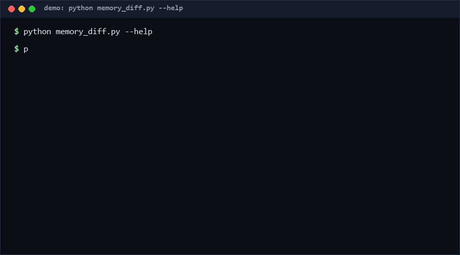

# transcript-memory-diff

**Agent memory drifts silently because nobody reviews what gets written. This tool turns an agent transcript into proposed memory bullets and emits a unified diff that a human approves — nothing auto-merges.** You need it if your agent keeps a memory file (AGENTS.md, memory.md, notes). Skip it if you want autonomous self-modifying memory with no gate. ~170 lines, pure Python stdlib.

---

<p align="center"></p>

## Problem

Long-running agents accumulate knowledge: decisions, constraints, root causes, user preferences. Two failure modes dominate how that knowledge is (not) captured:

1. **Auto-memory agents** write whatever looks relevant; drift is invisible until the agent confidently cites a memory nobody approved. There is no review artifact, so there is no review.
2. **Manual note-taking** loses the signal — the decisive sentence scrolls away in a 200-line transcript.

The missing piece is not another memory store. It is an **approval gate**: a small, reviewable diff between "what my memory says" and "what this session suggests it should say". Memory earns a place the same way code does — via review.

## How it works

```
 transcript.jsonl                    memory.md
 ({"role","text"} per line)              │
        │                                │
        ▼                                │
 ┌──────────────────────┐                │
 │ 1. jsonl parse       │ malformed lines │
 │ 2. sentence split    │ skipped, counted│
 │ 3. SIGNAL filter     │── only sentences with decision/
 │    (decided/must/    │   constraint/preference keywords
 │     never/root cause/│                 │
 │     偏好/决定/修复 …) │                 │
 │ 4. NOISE + length    │── chatter dropped, counted
 │ 5. dedupe (stable,   │                 │
 │    chronological)    │                 │
 └──────────┬───────────┘                 │
            │        new bullets only     │
            └────────────┬────────────────┘
                         ▼
        ┌─────────────────────────────────┐
        │ unified diff (memory.md →       │
        │ memory.md proposed)             │
        │ + stats: signal/noise/dedupe    │
        └────────────────┬────────────────┘
                         ▼
                 HUMAN approves → apply
                 (the tool never applies)
```

## Quickstart

```bash
# ~5 seconds: self-test (15 cases, pure stdlib)
python self_test.py

# ~1 min: build a diff from a real transcript
python memory_diff.py build transcript.jsonl --memory memory.md

# machine-readable: stats + proposed bullets
python memory_diff.py build transcript.jsonl --json

# ~5 min to integrate: pipe into your review flow
python memory_diff.py build session.jsonl --memory AGENTS.md > proposed.diff
# review proposed.diff; apply it yourself (git apply, or by hand)
```

## Comparison: why not X?

| Alternative | Human review gate? | Review artifact | Scope of change visible? | Verdict |
|---|---|---|---|---|
| Auto-memory agents (self-writing memory) | No | None | None — drift invisible | Convenient, unauditable |
| Manual note-taking | Yes (by hand) | The note itself | Only what you noticed | Loses most signal |
| Memory frameworks (mem0-class) | Configurable | Vector store entries | Hard to eyeball | Right for retrieval scale; heavy for a gate |
| Full transcript archiving | Implicit (read the log) | Whole log | Everything, so nothing stands out | Storage, not selection |
| **transcript-memory-diff** | **Yes — by construction** | **Unified diff** | Exactly the proposed delta | The missing approval layer |

## Minimal Fallback

No transcript files, no pipeline? Both degrade cleanly:

- **Stdin one-shot**: paste any JSONL into `python memory_diff.py build session.jsonl` (memory defaults to a fresh file) — a 30-second experiment with zero setup.
- **Just the signal regex**: `SIGNAL` is one auditable regular expression. Copy it into your editor as a saved search and skim transcripts manually — a strictly better manual workflow with zero code.

## Design Trade-offs

Priority order when conflicts arise: **no unreviewed writes > precision of signal > recall of signal**.

- **Keyword heuristic, not an LLM judge.** A model-based extractor would re-introduce the trust problem this tool exists to solve ("who reviewed the reviewer?"). Keywords are auditable, deterministic, and easy to extend per team; recall is knowingly imperfect (see Limits).
- **Append-only proposals.** The diff never deletes or rewrites existing memory. Rewriting memory is a separate, human-initiated act — otherwise the gate could silently launder content removal.
- **Deterministic dedupe over fuzzy similarity.** Near-duplicate bullets are kept if their text differs; merging them automatically risks dropping a meaningful nuance.
- **Length gates (20–300 chars).** Short = chatter, long = documents. The thresholds are constants at the top of the file, chosen to be seen and argued with, not hidden.

## Limits & Second-order Effects

- **Keyword recall is incomplete.** "We chose Postgres" is caught ("chose"); "Postgres it is" is not. Some genuine memories never reach the gate — an accepted cost of auditable extraction. If you miss signal, extend the regex, not the architecture.
- **Approval fatigue.** If a team's gate produces 20-proposal diffs daily, humans start bulk-approving — the gate becomes a rubber stamp with extra steps. Keep `--max-add` low; make candidates earn the diff.
- **Memory ossification.** An append-only gate with no pruning path biases memory toward accumulation; stale bullets stay forever. Schedule periodic human-led memory gardening sessions.
- **Transcript privacy.** Extracted bullets may quote users verbatim. If transcripts contain secrets, the signal regex does not know that — scrub transcripts before processing, and treat the memory file as sensitivity-inheriting.

## FAQ

**Q: When should I NOT use this tool?**
When memory entries must be structured (embeddings, keyed fields) rather than prose bullets — a diff of bullet lines cannot represent them. Also skip it if memory is single-user and disposable: the gate's cost only pays off when someone else (or future-you) must be able to trust the memory. And never use it as an *archive*: it selects signal, it does not preserve history. (Confidence: High — structural.)

**Q: Why keywords instead of an LLM summarizer?**
Because the tool's entire value is being the trusted, boring part of the pipeline. An LLM in the extraction path makes the gate itself unauditable. Use an LLM *before* this tool to clean transcripts if you like — the gate stays deterministic.

**Q: Why is there no --apply flag?**
The point is that nothing auto-merges. Applying an approved diff is one `git apply` away; the tool refusing to do it is a feature, not an omission.

**Q: Does the diff handle edited/deleted memories?**
No. Proposals are append-only (see Design Trade-offs). Deletion of a stale memory should be its own reviewed change — conflating the two is how unwanted deletions slip through review.

**Q: What do the stats numbers mean?**
`build --stats` prints lines/parsed/malformed/sentences/signal/dropped_noise/dropped_length/proposed/already_in_memory — the full accounting of why a transcript produced (or did not produce) a proposal, so you can tune thresholds with evidence.

## [Core Assumptions]

1. Memory is a plain-text, line-oriented markdown file where a bullet is a line; structured/vector memory stores are out of scope.
2. High-signal memory sentences contain recognizable lexical markers (decided/must/never/preferences/...); the regex is the definition, teams tune it.
3. A human reviews every diff before it is applied; the tool has no write path to the memory file, ever.
4. Transcripts are JSONL with a "text" field per entry; other shapes need a small adapter.
5. Append-only proposals are an acceptable memory-growth model, with periodic manual gardening compensating for the lack of automatic pruning.

## Key conclusions (with confidence)

- The approval-gate pattern (proposed diff, human apply) eliminates the unreviewed-memory-drift failure mode by construction — **High** (a diff either gets reviewed or does not get applied; there is no bypass path in the code).
- Keyword extraction catches the majority of decision/constraint sentences but misses paraphrases without markers — **High** (deterministic consequence of the mechanism; `--stats` quantifies recall on your own transcripts).
- Teams adopting a low-capped diff gate experience less memory drift than auto-memory baselines — **Medium** [estimated]; no longitudinal data ships with this repo, per the honesty rule. Run your own A/B: one month gated, one month ungated, compare memory accuracy.

Data reflecting repo state and test counts: as of 2026-10-11.

## License

MIT — see [LICENSE](LICENSE). Contact: hcac4735@agent.qq.com
